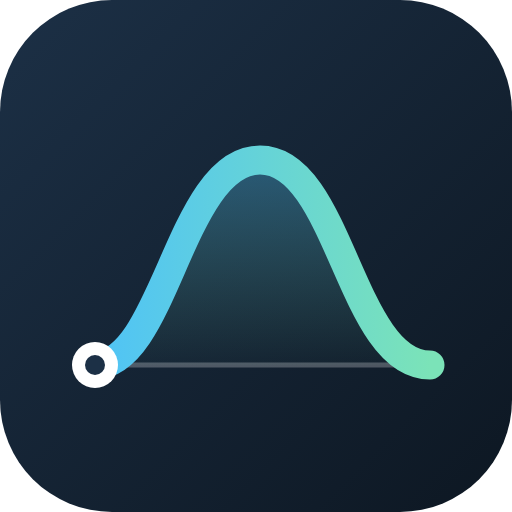
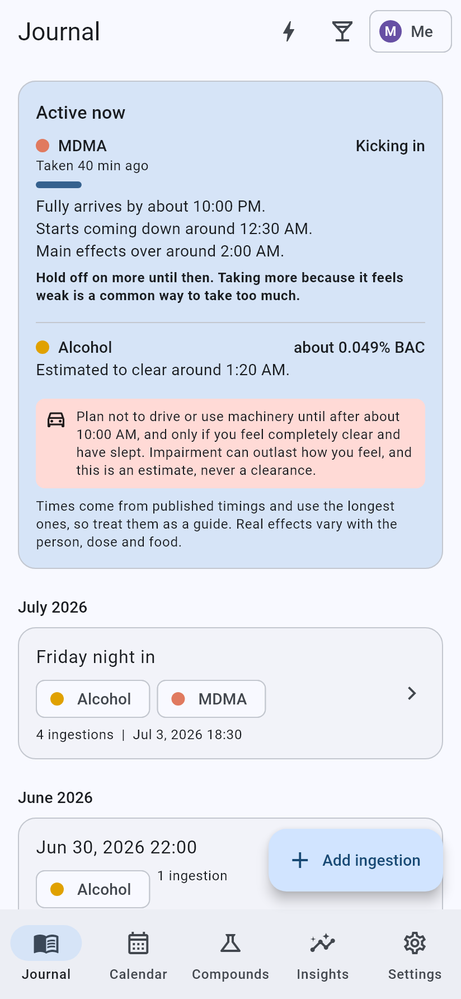
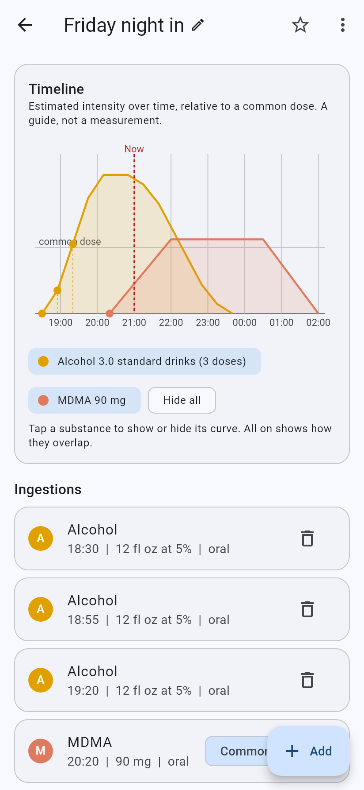
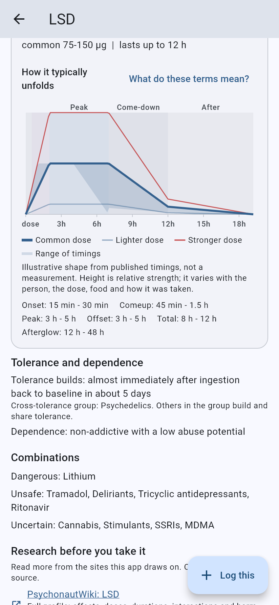
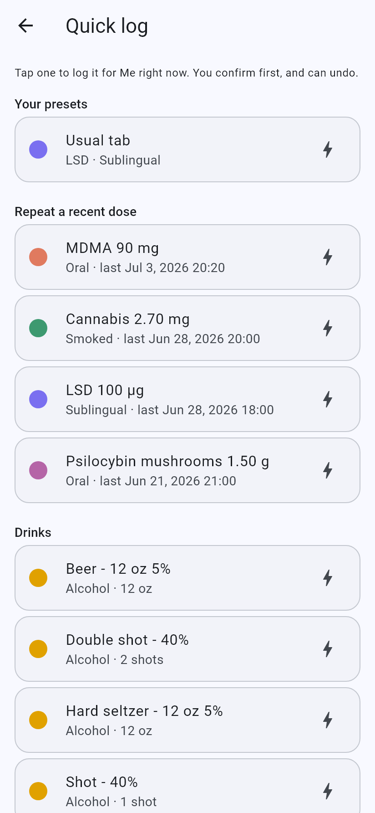
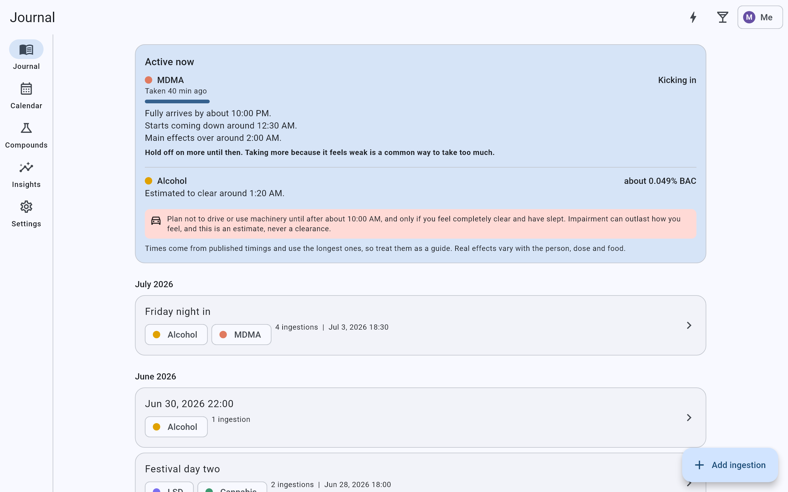
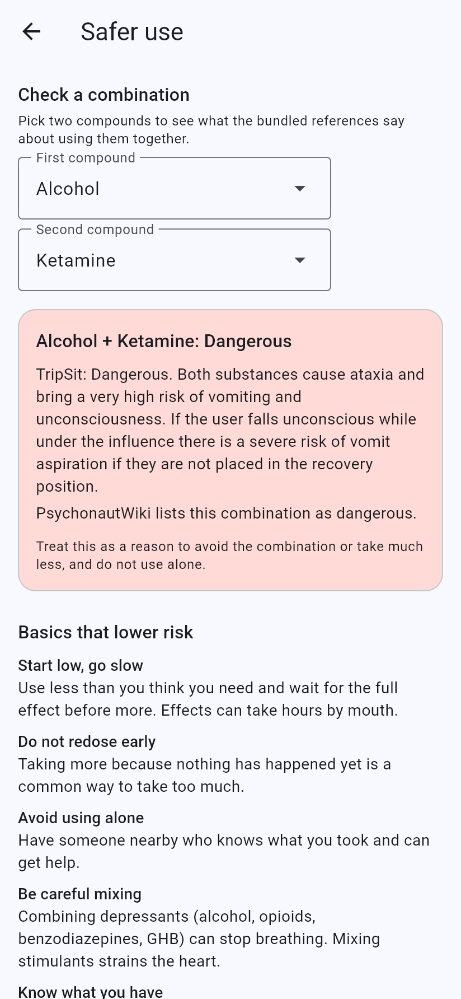
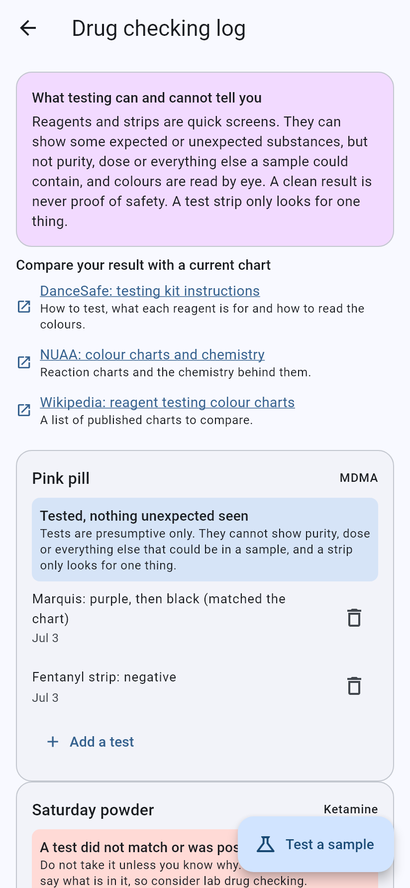
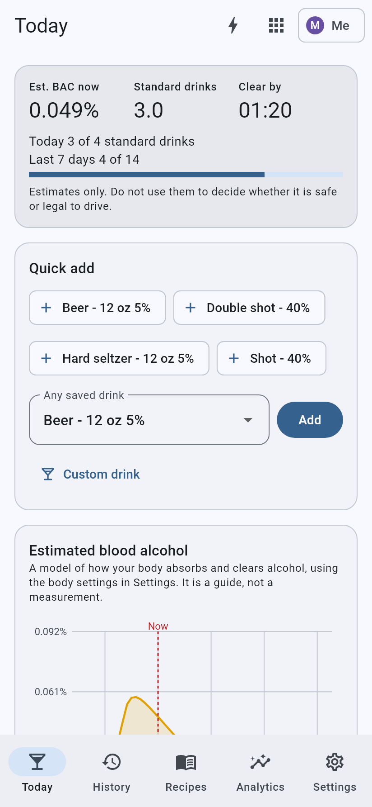
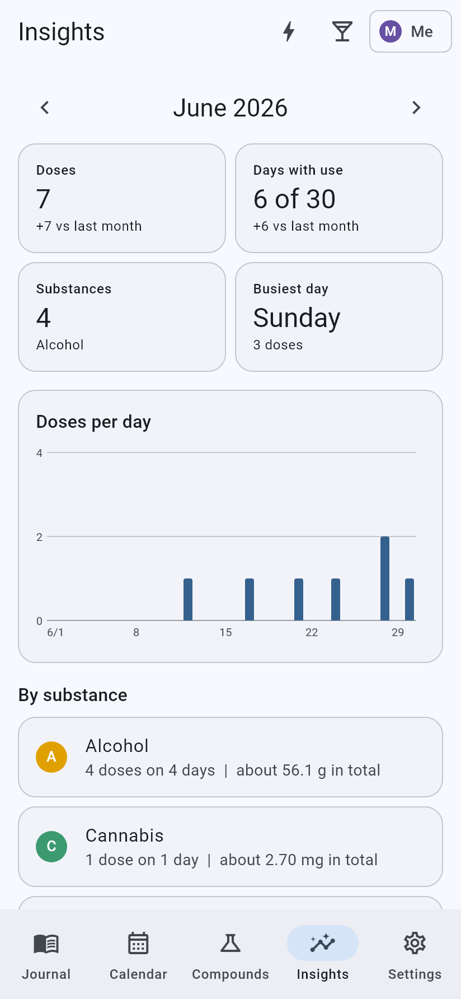

<div align="center">



# Substance Journal

**A private, offline harm-reduction journal for what you take: doses, timelines, risks and research, on your own devices.**

No account. No cloud. No server. Your data never leaves your phone and computer.

[](https://github.com/VirtualyMichael/substance-journal/actions/workflows/build.yml)
[](LICENSE)


[](../../releases)

 &nbsp;
 &nbsp;
 &nbsp;


</div>

> **Harm-reduction tool, not medical advice.** Doses, timings, blood alcohol, tolerance and effect curves are estimates
> modelled from published ranges. They are guides for planning and reflection, never measurements and never a
> clearance to drive or use machinery. The app has no synthesis, sourcing or acquisition information.

## Contents

[Why it exists](#why-it-exists) · [Features](#features) · [Download](#download) · [Getting started](#getting-started) ·
[Privacy and security](#privacy-and-security) · [Reference data and accuracy](#reference-data-and-accuracy) ·
[AI and voice access](#ai-and-voice-access) · [Build from source](#build-from-source) ·
[Project layout](#project-layout) · [Contributing](#contributing) · [Credits and license](#credits-and-license)

## Why it exists

Most tracking apps want an account, store your most sensitive data on someone else's server, and treat every substance
the same. Substance Journal is built the other way around:

- **Private by design.** Everything is stored in a local database. Syncing is device to device over your own Wi-Fi, and what travels is encrypted.
- **Per person.** Every curve, tolerance estimate and warning belongs to one person. Several people can share a device and a calendar without their data mixing.
- **Honest about uncertainty.** Estimates are shown as ranges and labelled as guides. A test never says a sample is "safe". Sources are linked, and where they disagree the app says so.
- **Useful in the moment.** Quick logging, what is still working right now, hold-off nudges while a dose is still arriving, and risky-mix warnings before you save.

## Features

### Journal and timelines

Log doses into **experiences** with notes, colour-coded timed notes and ratings. Several doses of one substance combine into
one curve with a mark per dose, and each substance can be switched on or off to see it alone or how things overlap. Hover or tap a
curve for the time, relative level, doses and, for alcohol, the estimated blood alcohol. Custom units ("1 pill = 120 mg"), custom
compounds and a calendar that shows who was on which day are built in.

<p align="center">

</p>

### Active now and safe-use nudges

The journal shows what is still working, which phase it is in (kicking in, coming up, at its strongest, coming down),
when it should be fully in, and when the main effects should be over, with a **hold-off note until a dose has fully arrived**.
Alcohol shows an estimated BAC and clear time. A deliberately cautious *"plan not to drive until..."* line is always
described as a guide, never a clearance. Optional notifications can tell you when a dose should have fully arrived, so there is no urge to
redose because it feels weak.

### Safety checks

Before you save a dose the app checks it against your own recent use and the references: strong or heavy doses, a repeat dose while the
last one is still active, high daily totals, raised tolerance, and risky combinations from the TripSit combination chart and
PsychonautWiki's interaction lists (unsafe and dangerous pairs are never downgraded). A **Safer use** page has a combination checker, the basics that lower
risk, and what to do in an emergency.

<p align="center">
 &nbsp;

</p>

### Drug checking log

Record reagent colour tests and test strips (fentanyl, benzodiazepine, xylazine) against a **sample**, then pick that sample when you log a dose.
A test that did not match or a positive strip shows a strong warning. The app compares nothing for you and never claims safety: colour charts differ
by brand and change, tests are presumptive, and a negative strip only means that strip did not detect that one thing. It links to current charts from
DanceSafe, NUAA and Wikipedia instead of baking colours in.

### Doses, presets and Quick log

- **Dose bands** (threshold, light, common, strong, heavy) per route, with the dose class shown as you type.
- **Presets.** Low, Medium and High filled from each route's reference ranges, plus your own saved presets (even a whole cannabis calculator setup).
- **Quick log** (the bolt in the app bar): one tap, then a confirm, logs a preset, repeats a recent dose or logs a drink, and warns if that substance is still active. On Android it also opens from the app icon's long-press menu, a Quick Settings tile and a home-screen widget.
- **Psilocybin mushrooms** are weighed in grams, dried or fresh (fresh counts as a tenth), with a pure-psilocybin option that converts for you.

### Alcohol mode

A focused drinking tracker: fl oz, shots and standard drinks instead of grams, a blood-alcohol model (Watson or Widmark with your body details),
daily and weekly limits with alerts, a 100+ drink recipe library (share codes compatible with
[Alcohol Tracker](https://github.com/VirtualyMichael/alcohol-tracker)), history, analytics and a month heatmap. Import your Alcohol Tracker history, presets and recipes
without duplicates.

<p align="center"> &nbsp; </p>

### Cannabis

Absorbed-THC estimates by method (joint, bong, vape, dab, edible, tincture) shown as a range, not false precision, with route-specific curves.
Save **strains and batches** (THC and CBD, type, source, cost per gram) and see doses, grams used and spend per product, plus which
product your own session ratings favour once there are enough of them (a hint, never proof).

### Tolerance, insights and your own summary

A per-person **tolerance and breaks** page pools cross-tolerant substances and estimates when you will be back to baseline. **Insights** gives a monthly summary,
and Settings can produce a printable **summary PDF** (last 30 days up to a year) with totals per compound, alcohol in standard drinks and a session list for a clinician or yourself.

### Compounds, research and a glossary

Around 280 compounds with doses, durations, tolerance, interactions and safety notes. Each route has a **mock timeline graph** (lighter, common and stronger doses with the
range of published timings), and each page links to PsychonautWiki, an Erowid search, the TripSit factsheet and combination chart, and more. A **Research and resources** page lists
the references worth reading before taking something, and a searchable **glossary** explains terms like come-up, afterglow and cross-tolerance.

### Sync, backup and import

- **Sync with no server.** Pair once with a QR code or pasted code. After that, paired devices on the same Wi-Fi sync automatically, or you can pass encrypted packages as QR codes, a file or text when there is no connection. Edits and deletes merge, and re-importing never overwrites, resurrects or duplicates anything.
- **Encrypted backup** with a passphrase, restore that never undoes newer edits, CSV and JSON export, and automatic daily and before-upgrade copies.
- **Duplicate clean-up** that keeps whatever extra one copy had, can combine nearby experiences into a day, and can be undone.
- **Imports** from PsychonautWiki Journal (with a review screen to choose what to keep and map compounds and routes) and from Alcohol Tracker.

### Reminders

Daily check-in, drinking-limit alerts and dose-timing alerts. All are local to the device and each can be switched off.

## Download

Get the latest build from [**Releases**](../../releases).

| Platform | What to get |
|---|---|
| **Windows** | `SubstanceJournal-2.0.0-setup.exe` (installer), or the `windows-x64.zip` to unzip and run. Windows may warn because the installer is not code-signed: choose *More info*, then *Run anyway*. |
| **Android** | `SubstanceJournal-2.0.0-android.apk`. Open it on the phone and allow installing from your browser or files app. Updates install over it. |
| **Linux and iOS** | Built from the same code by the [CI workflow](.github/workflows/build.yml) but not yet run on a device. iOS needs a Mac and an Apple developer account to install. |

This is a **preview**. Windows and Android are used by hand; please report anything that breaks.

## Getting started

1. Open the app, tap **Add ingestion**, choose a compound and route, and enter a dose (or tap Low, Medium or High). Heads-ups appear as you go.
2. Save presets you use often so they are one tap in **Quick log**.
3. To use two devices: on one, open **Settings, Sync devices** and show the pairing QR code, then scan or paste it on the other. After that they sync by themselves while both apps are open on the same Wi-Fi.
4. In **Settings** choose notifications, drinking limits, body details (for blood-alcohol estimates), an encrypted backup, and your accent colour.
5. Coming from Alcohol Tracker or PsychonautWiki Journal? Import from Settings. Nothing you edit is overwritten if you import twice.

## Privacy and security

- **Local first.** Data lives in a SQLite database in the app's folder on each device. There are no accounts, analytics or telemetry.
- **Sync is encrypted.** Packages are compressed and sealed with AES-256-GCM using a key created when you pair, so the network never sees journal data and a device without the key can neither read nor change anything. Wi-Fi sync uses a small local HTTP port while the app is open, with UDP discovery.
- **Backups** are sealed the same way from a passphrase (PBKDF2-HMAC-SHA256, 150,000 iterations).
- **Links open your browser.** Research links leave the app only when you tap them. The app downloads nothing in the background.
- **Android signing.** Releases are signed with the project's own key. Keep your own backups before moving between builds signed with different keys, because Android will not install over a differently signed app.

Found a vulnerability? Please read [SECURITY.md](SECURITY.md).

## Reference data and accuracy

Doses, durations, tolerance and interactions come from [PsychonautWiki](https://psychonautwiki.org) (CC BY-SA 4.0), [TripSit](https://tripsit.me)'s open drug and combination data
(CC BY-SA 4.0), and, for the hand-audited compounds, Erowid and peer-reviewed studies. Every compound says how far to trust it:

| Level | Count | Meaning |
|---|---|---|
| **Audited** | 9 | Alcohol, nicotine, cannabis, psilocybin mushrooms, LSD, DMT, MDMA, 2C-B and ketamine were checked by hand against several sources, with every change documented in [docs/data-audit](docs/data-audit/SUMMARY.md). Where sources disagreed the more conservative range wins. |
| **Cross-checked** | 87 | Copied from PsychonautWiki, and TripSit's data lists dose bands within 50% with overlapping timings. Two sources agreeing, not an independent audit. |
| **Copied, sources differ** | 103 | The app shows where PsychonautWiki and TripSit disagree and says to start with the lower figure. |
| **Copied** | the rest | From PsychonautWiki only, labelled as not independently checked. |

The cross-check is reproducible: `python scripts/crosscheck_tripsit.py` regenerates [the report](docs/data-audit/crosscheck.md). See
[docs/ATTRIBUTION.md](docs/ATTRIBUTION.md) for licences and credit, and [docs/ROADMAP.md](docs/ROADMAP.md) for what is done and what is next.

## AI and voice access

[`mcp/substance-journal`](mcp/substance-journal) is an optional [MCP](https://modelcontextprotocol.io) server that lets Claude, a voice assistant or another agent read reports from
and log into the journal's database on your computer. It only adds rows (stamped like another device so they sync to your phone), can remove only entries it made itself,
and every log reads back what it will do and waits for a yes first. Tools: `log_drink`, `log_dose`, `undo_last`, `report`, `list_people`, `list_presets`.

## Build from source

You need [Flutter](https://docs.flutter.dev/get-started/install) 3.47 or newer. From `app/`:

```bash
flutter pub get
flutter test                       # app tests
(cd packages/sj_core && dart test) # core library tests
flutter run -d windows             # or an Android device, linux, ios
flutter build windows --release
flutter build apk --release
```

- **Windows installer:** `scripts/build_windows_installer.ps1` (needs [Inno Setup 6](https://jrsoftware.org/isdl.php)).
- **Android release key:** `scripts/make_android_keystore.ps1` creates a signing key outside the repository. Without it, release builds use the debug key.
- **Reference data:** `scripts/sync_substance_data.py` (with `--extra` for the broad catalogue), `scripts/sync_app_assets.py` to copy it into the app, and `scripts/crosscheck_tripsit.py` for the TripSit cross-check. Python tests: `python -m unittest discover tests`.
- **README screenshots** are rendered from made-up demo data: `SJ_SCREENSHOTS_DIR=../docs/screenshots flutter test test/readme_screenshots_test.dart`.

GitHub Actions builds and tests Windows, Linux, Android and iOS on every push.

## Project layout

```
app/                          Flutter app (Windows, Android, Linux, iOS)
  lib/data/                   database (Drift), sync, backup, importers, reminders, reports
  lib/ui/                     screens: journal, compounds, alcohol, quick log, testing, settings ...
  packages/sj_core/           pure-Dart logic: reference data, dosing, curves, alcohol, sync format
  test/                       widget and unit tests, README screenshot generator
mcp/substance-journal/        MCP server for AI and voice access
data/                         reference data (audited nine, broad catalogue, TripSit cross-check)
scripts/                      data sync, cross-check, Windows installer, Android key
docs/                         roadmap, attribution, data-audit reports, screenshots
substance_journal/            the original Python/PySide6 prototype this app grew from
```

Built with Flutter, Riverpod, Drift (SQLite), `cryptography`, `pdf`, `flutter_local_notifications` and `mobile_scanner`.

## Contributing

Bug reports, corrections to reference data and ideas are welcome. See [CONTRIBUTING.md](CONTRIBUTING.md). For data corrections, a link to the source you are
relying on makes a fix far easier to check.

## Credits and license

Code is licensed under **GPL-3.0** (see [LICENSE](LICENSE)). Reference data derived from PsychonautWiki and TripSit remains under **CC BY-SA 4.0**.
Thanks to [PsychonautWiki](https://psychonautwiki.org), [TripSit](https://tripsit.me), [Erowid](https://www.erowid.org), [DanceSafe](https://dancesafe.org) and the harm-reduction community whose
work this builds on. Substance Journal is an independent project and is not affiliated with any of them.
